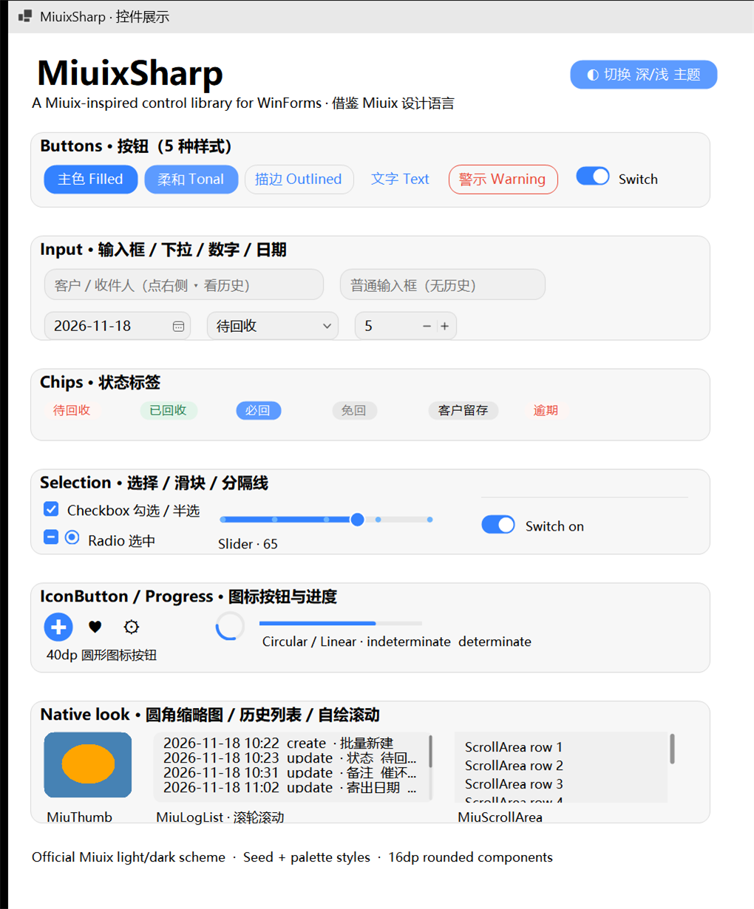
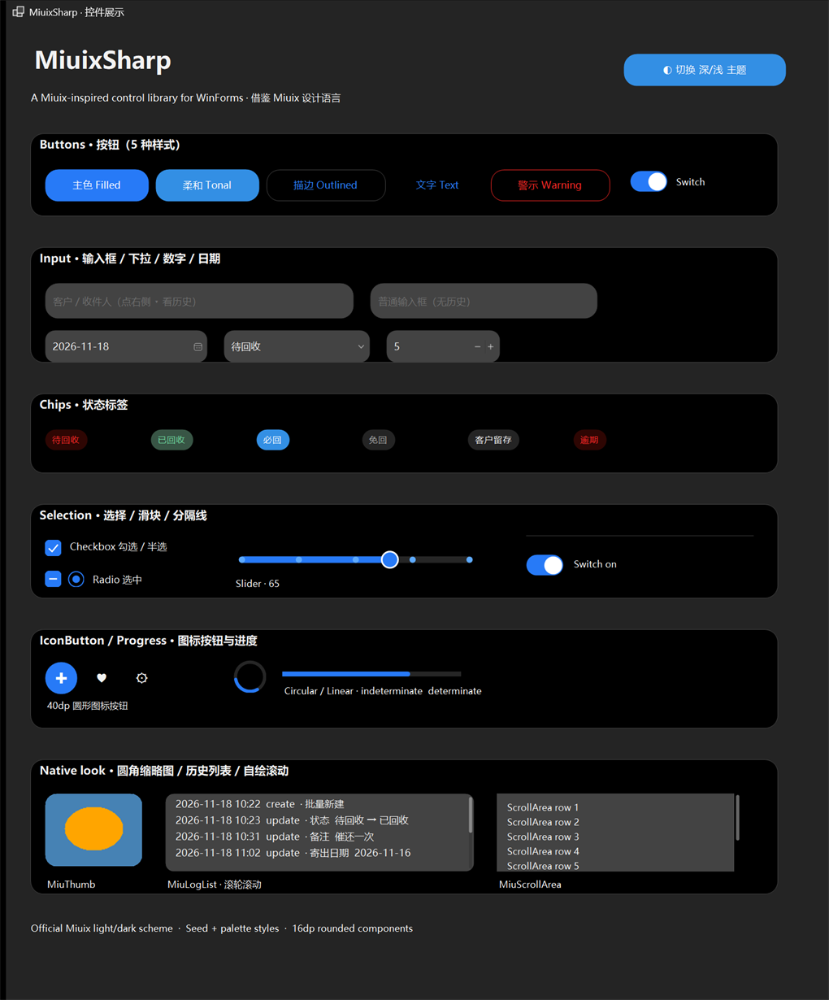

# MiuixSharp

A Miuix-inspired control library for **WinForms on .NET 8** — rounded cards, tonal colors, squircle corners, and a complete named color-role system, in pure C# with no extra dependencies.

> **⚠️ Attribution / 致谢**
> This is an **independent, unofficial reimplementation** of the **visual design language** of
> [Miuix](https://github.com/compose-miuix-ui/miuix) (by [yukonga](https://github.com/yukonga)),
> created for the WinForms desktop platform. Miuix itself is a **Kotlin / Jetpack Compose** library
> and cannot be referenced from C#; this project re-creates its look and theme system from scratch in C#.
> All design credit belongs to the original Miuix authors. This project is **not affiliated with,
> endorsed by, or officially connected to** the Miuix project or Xiaomi. See [CREDITS.md](CREDITS.md).

| Light (100% / 96 dpi) | Dark (100% / 96 dpi) |
|:---:|:---:|
|  |  |

Live feature page (GitHub Pages): **https://jonah-77.github.io/MiuixSharp-WinForms/**

## Why

WinForms controls still look like Windows 95. If you want a modern, soft, "Xiaomi HyperOS" feel —
rounded corners, layered surfaces, a single accent blue that drives every control — without
rewriting your app in Compose or Electron, this library drops that look into an existing WinForms
project with minimal changes.

## Features

- **Complete Miuix color system** — the official light/dark named color roles (`primary`,
  `primaryContainer`, `tertiaryContainer`, `surfaceContainer*`, `error`, `dividerLine`, disabled
  families … ~50 roles) ported value-for-value from Miuix's docs.
- **Theme modes** — `Light` / `Dark` / `System` (auto-follows Windows app theme).
- **DPI-correct layout** — every metric is dp and converted at draw time; scales 1.0–5.0
  (Windows' own 100%–500% range), follows monitor changes via `MiuDpi.Watch`, no bitmap stretching.
- **Monet-style seed colors** — set one `Seed` color and get a full tonal palette; 5 palette
  styles (`TonalSpot`, `Neutral`, `Vibrant`, `Expressive`, `Monochrome`).
- **Miuix text styles** — all 14 styles (`title1..4`, `body1/2`, `button`, `footnote1/2` …).
- **Exact component metrics** — 16dp corner radius, 40dp button height, 28dp slider,
  0.75dp divider, 3.855dp slider key points — matching Miuix defaults.
- **Replicated controls**
  `MiuButton`, `MiuCard`, `MiuSwitch`, `MiuCheckBox` (tri-state), `MiuRadioButton`, `MiuSlider`,
  `MiuDivider` (H/V), `MiuTextBox` with history suggestions, `MiuChip`, `MiuIconButton`,
  `MiuProgressIndicator`, `MiuGrid`, `MiuSurface`.
- **Rounded input family** — WinForms' `TextBox` / `ComboBox` / `NumericUpDown` / `DateTimePicker`
  are square and border-drawn, which breaks any rounded layout. `MiuField` provides one shared
  rounded shell (tonal fill, focus ring, trailing affordance) and four editors sit on top of it:
  `MiuInput` (text + optional suggestion list), `MiuComboBox` (owner-drawn dropdown),
  `MiuNumberBox` (`−/+` stepper, no native spinner) and `MiuDateBox` (custom month-grid calendar).
- **Native-chrome replacements** — the remaining pieces of the Windows look:
  `MiuScrollArea` (self-drawn scroll host, no arrow-button scrollbar), `MiuLogList`
  (read-only history list with a thin rounded indicator), `MiuThumb` (rounded image frame),
  `MiuActionGrid` (DataGridView that shows the hand cursor over action columns) and
  `MiuTitleBar` (recolours the OS title bar through DWM so it is not the default accent blue).
- **Drop-in compatibility** — `MiuWinButton` derives from `System.Windows.Forms.Button`, so it
  slots into legacy code (`Dock`, `FlatAppearance`, `DialogResult`) unchanged.

## Install

Clone and reference the project, or build the DLL:

```bash
dotnet build -c Release src/MiuixSharp/MiuixSharp.csproj
```

Add a project reference in your WinForms app:

```xml
<ItemGroup>
  <ProjectReference Include="path/to/MiuixSharp.csproj" />
</ItemGroup>
```

Requires **.NET 8 with Windows Forms** (`net8.0-windows`, `<UseWindowsForms>true</UseWindowsForms>`).

## DPI and scaling

Every metric in MiuixSharp is a **dp** value (Miuix's unit), converted to device pixels at draw
time — so the library keeps its proportions on any monitor instead of relying on WinForms' own
bitmap stretching.

| Rule | Value / behaviour |
|---|---|
| Baseline | 96 dpi = scale `1.0` — exactly what the screenshots show |
| Supported range | **1.0 – 5.0** (100% – 500%), the same range Windows itself allows; anything outside is clamped, never silently ignored |
| Units | all public size / radius / spacing properties are dp; controls call `MiuTheme.Dp()` inside `OnPaint` |
| Text | specified in **pt**, so the OS scales it with the DPI — no manual conversion |
| Hairlines | floor of 0.75 px (`MiuTheme.Dpf()`), so a 0.75 dp divider stays visible at 100% |
| Window | size it in dp too (`MiuTheme.Dp(1020)`), otherwise high-DPI content overflows a fixed window |
| Live changes | `MiuDpi.Watch(form)` hooks `DpiChanged`; every live control re-measures and repaints |

```csharp
public MainForm()
{
    MiuDpi.Watch(this);                                          // follow this monitor's DPI
    ClientSize = new Size(MiuTheme.Dp(1020), MiuTheme.Dp(760));  // design size, expressed in dp
}
```

App-level zoom goes through the same clamp:

```csharp
MiuTheme.SetScale(1.25f);   // clamped into 1.0 .. 5.0
```

Zooming *below* 1.0 is deliberately not offered: Windows cannot scale below 100% either, and
because MiuixSharp text is in pt, a factor under 1.0 would shrink the boxes while the glyphs
stay the same size. If a window is too small for the content, it should scroll (`MiuScrollArea`)
rather than shrink.

Do **not** combine this with `AutoScaleMode = Dpi` on the same form — that applies the factor
twice. Leave the form at `AutoScaleMode.None` (or `Font` for legacy dialogs) and let
MiuixSharp do the dp→px step.

Reference points: Windows display scaling is defined as 100%–500% (Microsoft Support,
"Make Windows easier to see"); Windows Forms' own per-monitor guidance is `PerMonitorV2`
with linear `AutoScaleMode.Dpi` — which is exactly the doubling this library avoids by
scaling from dp itself.


## Quick start

```csharp
using MiuixSharp.Controls;
using MiuixSharp.Theme;

// Optional: use a seed color (Monet-style) instead of the default Miuix blue
MiuTheme.Seed = Color.FromArgb(0x34, 0x82, 0xFF); // #3482FF

// Optional: follow the system light/dark setting
MiuTheme.Mode = MiuMode.System;

var primary = new MiuButton { Text = "Primary", Style = MiuButtonStyle.Filled };
var card    = new MiuCard   { Text = "A rounded Miuix-style card", Size = new Size(300, 120) };
var sw      = new MiuSwitch { Checked = true };
var chip    = new MiuChip   { Text = "已回收", Tone = MiuChipTone.Success };
```

Switching `MiuTheme.Mode`, `Seed`, or `PaletteStyle` repaints every live control automatically via
the `MiuTheme.Changed` event.

### Drop into an existing WinForms button

```csharp
// Before:  var b = new Button { Text = "Save" };
// After:   same code, rounded look:
var b = new MiuWinButton { Text = "Save", MiuStyle = MiuButtonStyle.Filled };
```

### Text field with removable history suggestions

```csharp
var field = new MiuTextBox { Placeholder = "Customer" };
field.HistoryProvider = () => customers;              // most-recent first
field.OnDeleteHistory = value => { customers.Remove(value); return true; };
```

### Rounded inputs (replacing the native square editors)

```csharp
// text — 34px compact row, radius 10
var name = new MiuInput { Placeholder = "客户 / 收件人" };

// dropdown — owner-drawn list, no native ComboBox frame or system arrow
var status = new MiuComboBox();
status.SetItems(new[] { "待回收", "已回收", "客户留存" });
status.SelectedIndex = 0;

// number — segmented −/+ inside the field instead of the NumericUpDown spinner
var count = new MiuNumberBox { Minimum = 1, Maximum = 99, Value = 5 };

// date — rounded field + custom month grid (primary-filled selection, ring on today)
var due = new MiuDateBox("2026-12-01", nullable: true);
string stored = due.DateText;                         // null when cleared
```

All four share `Radius`, `InsideMargin` and the `MiuField` focus/hover states, so a form that
mixes them stays visually consistent. `MiuInput` draws its placeholder through the hosted
`TextBox` (a shell-painted hint would be covered by the opaque edit control).

## Design fidelity

See [docs/REPRODUCTION.md](docs/REPRODUCTION.md) for the full item-by-item audit against Miuix's
source tree: which components and theme roles are reproduced, which are approximated, and which
are intentionally omitted because they are platform-specific (Glass blur, Compose navigation,
Preference screens).

For the internal design rationale, the WinForms gotchas that shaped the code, and a hand-over
checklist, read **[项目说明与交接文档.md](项目说明与交接文档.md)** (Chinese).

## Project structure

```
src/MiuixSharp/
  Theme/     MiuTheme, MiuColorScheme, MiuTextStyles, TonalPalette
  Drawing/   RoundedPath (rounded / squircle geometry)
  Controls/  Button, WinButton, Card, Switch, CheckBox, RadioButton, Slider,
             Divider, Chip, IconButton, ProgressIndicator, Grid, Surface
  Controls/  Field (rounded input shell), Input, TextBox, ComboBox,
             NumberBox, DateBox, Popup (dropdown card + shared list)
  Controls/  ScrollArea (self-drawn scroll host), LogList (history list),
             Thumb (rounded image), ActionGrid (hand cursor on action columns),
             TitleBar (DWM title-bar recolouring)
samples/MiuixSharp.Showcase/   Live demo used for the screenshots above
docs/REPRODUCTION.md           Fidelity audit
docs/index.html                Feature page published to GitHub Pages
docs/*.png                     Light & dark screenshots
项目说明与交接文档.md            Chinese hand-over doc: design decisions, pitfalls, checklist
```

## License

MIT — see [LICENSE](LICENSE).

The Miuix project is licensed under Apache-2.0; this project only re-implements the visual design
language and does not copy Miuix source code. See [CREDITS.md](CREDITS.md).
